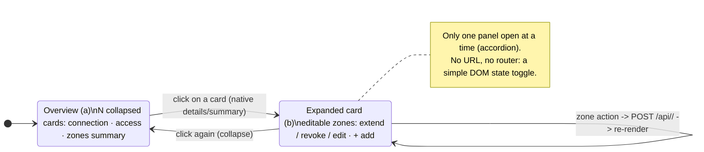
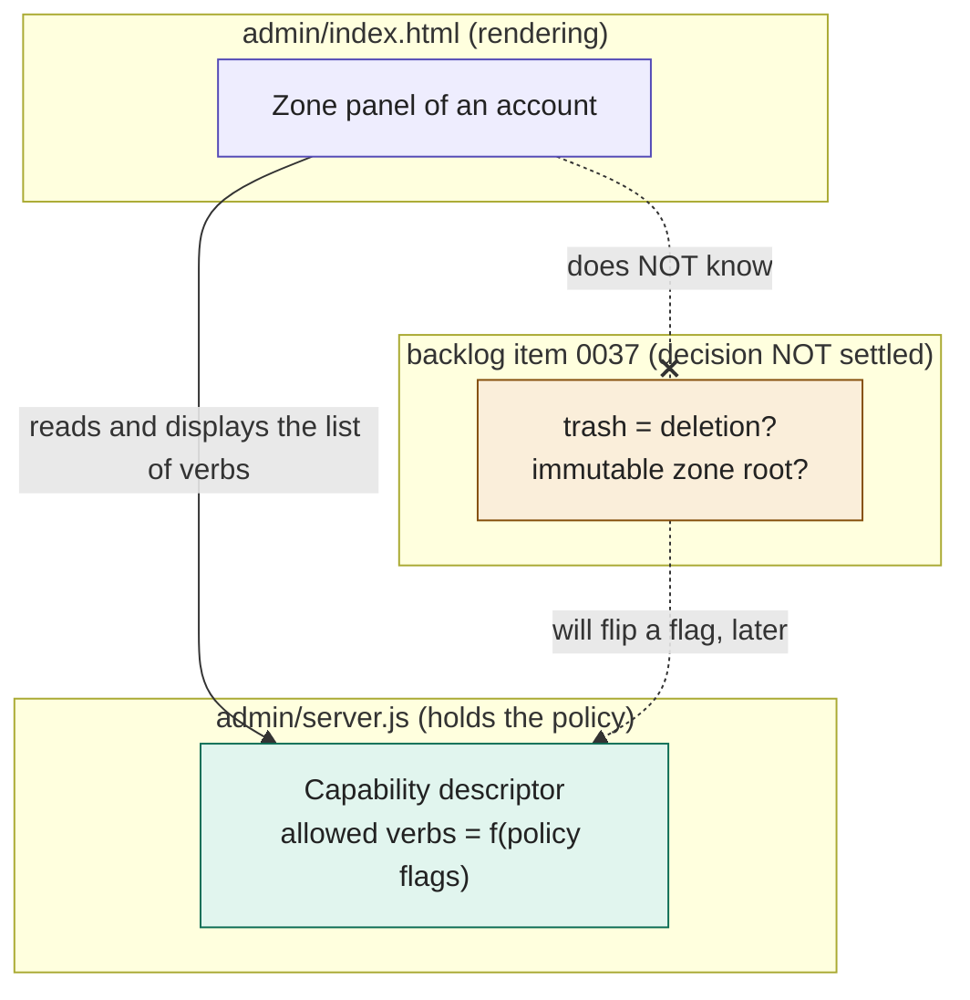

# ADR-0004 — Admin: master list → detail page, without a router

Status: **accepted** — implemented (backlog item 0036, mockup v11) · revised 2026-07-28 · Scope: `admin/index.html` + `admin/server.js`

> **Ratification 2026-07-28 (implementation, mockup v11).** The original **accordion** form
> (`
/
`) is **abandoned** in favor of a **master list →
> detail page**: a DOM state swap (`VIEW = {mode:'list'|'detail'}`, functions
> `renderList` / `renderDetail`), **still without a router or URL**. Decision 1 below
> is therefore revised accordingly; figures 1-2 illustrate the initial accordion
> exploration and hold for the spirit (two states, no navigation), not for the final form.
>
> **Deviations accepted at ratification** (relative to decisions 2 and 3 as written):
> - **Decision 2** — zone editing lives in the existing **Zones dialog** (the
>   "Zones…" button on the Drive row of the detail), which already carries the per-zone actions
>   (extend / revoke / add), rather than in inline editable rows in the panel.
>   Same function, form = reused modal (zero dependencies, no rewrite).
> - **Decision 3** — the server exposes the **raw policy flags** (`/api/profiles` →
>   `policy`); the front end **derives** the rights labels from them (`capsHtml`, `SVCDEF` table).
>   The invariant that holds is the essential one: **the front end never asserts a right as hard-coded** — each
>   "green / red" comes from a real flag. The flag → label mapping (shared, a single table)
>   lives on the front-end side rather than the server side; the 0037 switch (trash = deletion) will
>   still act only on a server flag (`delete`), not on the front end.
Related backlog items: 0036 (card clarity), 0037 (semantics of deletion in a zone)

> **TL;DR** — The administration web page (which manages the connected Google accounts) drops the expandable "accordion" cards in favor of a clickable list that switches to a per-account detail page — with no URL or router, just a change of on-screen state — so that it stays a single page with no dependencies; and the rights displayed for each account are **derived in the browser** from the raw policy flags served by the server (`/api/profiles`), rather than hard-coded in the page.

## Context

The local web admin is a **single** vanilla HTML/CSS/JS page (no framework,
no router, no build), served by `admin/server.js` in **pure stdlib Node
(zero dependencies)**. Data arrives as JSON (`GET /api/profiles`), actions
go out as `POST /api/<alias>/<action>` to `bin/mag`.

We want to move from a simple list of cards to:
(a) an **overview** (all accounts, summarized);
(b) a per-account **detail** where Drive write zones are visible and
**editable inline** (per zone: extend, revoke, edit).

Two possible forms: a master list alone with **in-place expansion**, or
**master + detail view** (which requires some form of navigation/routing).

Cross-cutting constraint: the warning text shown when a zone is set
("the LLM will be able to create/modify/trash…") **depends on an unresolved
policy decision** (backlog item 0037: trash = deletion? immutable zone root?).
The UI must not freeze that decision.

## Decision

**1. Master list → detail page, by DOM state swap** (~~accordion
`
/
`~~, revised — see ratification at the top). A single state
`VIEW = {mode:'list'|'detail', alias}` and two render paths (`renderList` /
`renderDetail`) in the same `#cards`: the list shows one row per account
(toggle · padlock · count · chevron); clicking a row renders the detail page
(rights per app, zones, danger zone); "‹ Accounts" goes back to the
list. **Still no router** — neither a hash on the front end nor an HTML route on the
server side: a simple state toggle, a single artifact.

**2. Zone editing lives in the expanded panel of the card.** Each zone
is a row of the panel carrying its own actions (extend / revoke /
edit); the collapsed summary (`1 temporary · expires in 1 h 58`) remains the
condensed view. The "add a zone" button is at the foot of the panel.

**3. The zone warning is DATA supplied by the server, not a string coded in the front end.** `server.js` (which holds the policy) exposes, per
service and per profile, the list of **verbs actually allowed** (create,
modify, trash…) derived from the policy flags. The front end **renders** this
list; it never asserts a verb as hard-coded.

*Figure 1 — Interaction model: the overview and the detail are two
states of the SAME card (collapsed / expanded), linked by native `
`; no
navigation or URL is introduced.*

*Figure 2 — Decoupling: the front end (purple) depends on an abstraction, the
capability descriptor (green); decision 0037 (amber) will act only on a server
flag. Solid line = accepted dependency; dotted = future influence; cross
= the front end has no direct link to 0037. Settling 0037 will not touch
`index.html`.*

## Rejected options

- **Master + detail view with a hash router** (`#/profile/perso`): requires a
  home-made mini-router (parsing `location.hash`, view swap, back-button handling)
  + two render paths to keep in sync. YAGNI for 5–20 accounts.
- **Server HTML route `/profile/<alias>`**: duplicates the layout, one
  network round trip per account, breaks the single page.
- **Detail in a `<dialog>` modal**: dependency-free but locks you into one account, prevents
  scanning/comparing zones across accounts; heavier than inline.
- **Warning hard-coded in the front end** (current state of the mockup):
  couples the UI to the 0037 semantics, which are still open.

## Consequences

- **+** Zero new dependencies; a single render path; accessible and free
  expansion (native `
`, already used for the ⋯ menu).
- **+** Scales by scrolling; **only one panel open at a time**
  keeps the DOM small and attention focused.
- **+** 0037 can be settled without touching `index.html`: only the verb
  descriptor in `server.js` changes.
- **−** Long expanded panel on a small screen → mitigated by the accordion (one open)
  and a `scrollIntoView` on opening.
- **−** Small backend addition: expose the allowed verbs per service/profile
  in `/api/profiles` (or a dedicated endpoint). This is the right home — the policy
  lives on the server side (DIP).
- At 20+ accounts, plan a filter/search at the top of the list (cheap, later);
  out of scope for the POC.
