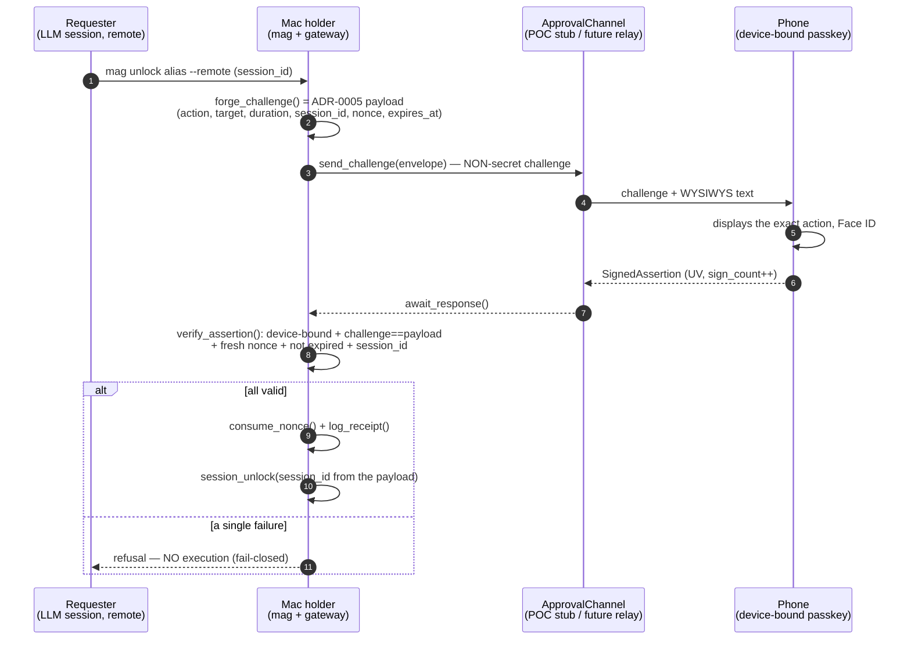
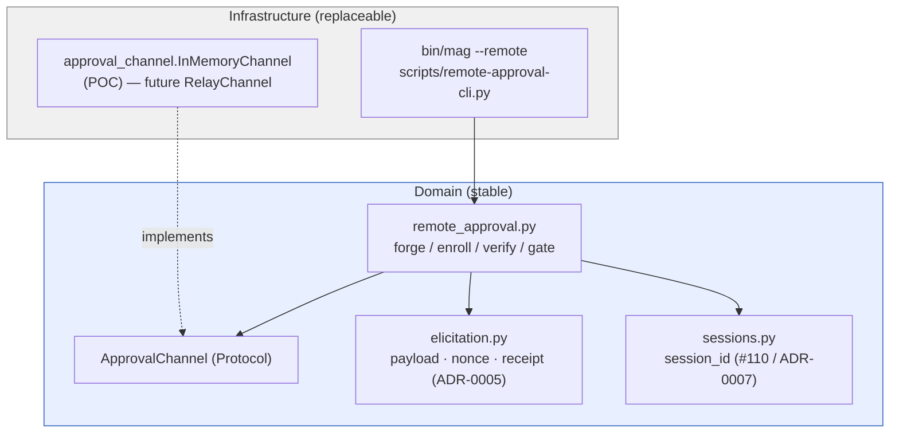

# ADR-0009 — Passkey approval from the phone (POC, Mac holder)

**Date**: 2026-08-16
**Status**: accepted (POC — backlog item 0078, phase 1 of epic 0077 / ADR-0008)
**Deciders**: team (Architecture step of the sprint)

> **TL;DR** — When driving a session **away from the Mac**, the approval of an `unlock`/`grant`
> can be signed by the **phone's passkey** instead of the Mac's Touch ID. We **reuse
> as-is** the signed elicitation foundation (ADR-0005): same canonical payload describing the action
> (WYSIWYS), same anti-replay `nonce`, same receipt, same `session_id` binding (ADR-0007). The
> phone is **just one more signer**: it holds no Google token and executes nothing.
> The Mac **forges** the challenge, **transports** it to the phone through a channel interface
> (in-memory stub for the POC), **verifies** the *device-bound* signature and executes **only**
> if everything is valid — otherwise nothing (fail-closed). The Mac's Touch ID stays unchanged.

## Context

Approval of a sensitive action currently goes through the **Mac's Touch ID**: `bin/mag`
builds a payload `{action, alias, email, target, session_id, minutes|hours}`, calls
`scripts/elicitation-cli.py gate`, and `gateway/elicitation.run_elicitation_gate` **forges** the
canonical payload (adding `nonce`/`issued_at`/`expires_at`), **obtains a signature**
(`obtain_signature` → Swift Secure Enclave, or HMAC mock in CI), **verifies** it
(`verify_signature`), **burns the nonce** (`consume_nonce`) and **logs** (`log_receipt`).
The signature is therefore **produced locally** — impossible to approve from a phone when the
agent runs elsewhere (Remote Control, Dispatch).

ADR-0008 settled the direction: separate *who asks* / *who approves* / *who holds*, and
migrate the signer to a **passkey** (WebAuthn/FIDO2, biometrics). Backlog item 0078 is its
**phase 1, low risk**: the Mac **stays the holder** (vault + broker unchanged), only the
**approver** moves to the phone. Strong constraints: **fail-closed everywhere**,
**no guard removed** (Mac Touch ID, default-deny policy, session layer #110 intact),
**reuse** ADR-0005 + sessions (do not recode a parallel signature/nonce mechanism).

## Decision

### 1. The passkey is **one more signer**, not a parallel mechanism

The extension seam is the **`obtain a signature` / `verify`** pair. We **keep intact** the
backbone of ADR-0005 — canonical payload, `consume_nonce`, `log_receipt` — and plug a second
signer in beside it. `run_elicitation_gate` (Touch ID) is **not modified**;
we add a **sibling** `run_remote_approval_gate(fields, channel)` that shares the same
primitives. The local vs remote choice is made **by the caller** (CLI `--remote`), never by
default: remote approval **adds** a path, removes none.

### 2. Challenge model = ADR-0005 payload, **bound to the session**

`forge_challenge(fields)` reuses `elicitation.build_payload()`: the challenge **is** the
canonical JSON payload, which already carries `session_id` (ADR-0007), `nonce`, `issued_at`, `expires_at`, and
from which `prompt_from_payload()` derives the **WYSIWYS** text (account, target, duration) shown on the
phone. The challenge **does not need to be secret**: safety comes from WYSIWYS + signature
verification on the Mac. The passkey signs this challenge as a **WebAuthn challenge**; verification
requires that the assertion's `challenge` be **exactly** the forged canonical payload — so
another action or another `session_id` cannot be substituted.

### 3. **Device-bound** verification (refuse a *synced passkey* / a PIN)

- **At enrollment** (`enroll_phone`), we inspect the WebAuthn flags of the `authenticatorData`:
  we **refuse** if `BE` (*backup-eligible*) is set — a *backup-eligible* passkey is
  syncable (iCloud / Google Password Manager), hence **not bound to this device**; we
  **require** `UV` (*user-verified*). A PIN is refused through an enrollment policy that requires
  **biometric verification** (in production derived from the `attestation`/`AAGUID` — an allowlist
  of platform authenticators). We record **only the public key** (COSE/SPKI),
  `credential_id`, `aaguid`, and an initial `sign_count`.
- **At each approval** (`verify_assertion`): `UV` set, `BE` not set, signature valid
  against the enrolled public key, `sign_count` **strictly increasing** (anti-cloning), challenge ==
  forged payload, `nonce` fresh (`consume_nonce`), not expired. A single failure ⇒ **total refusal**.

### 4. The channel behind an **interface** (POC stub / deferred relay)

`ApprovalChannel` (Protocol) = `send_challenge(envelope) -> request_id` +
`await_response(request_id, timeout) -> SignedAssertion | None`. The domain depends on
**the abstraction**, never on an implementation (DIP). The POC provides **`InMemoryChannel`** (the
test signer fetches the challenge and answers in-process). The real transport — **E2E-encrypted blind
relay** / push — is a **second implementation** of the same interface, deferred to
epic 0077.

### 5. Preservation of invariants

The Mac stays the **holder**: no Google token leaves the Mac, the phone holds **only**
its passkey private key (in its enclave) and **no Google secret**. The Mac stores only the phone's
**public key**. Touch ID remains the default path in front of the Mac. After
verification, the action runs with the `session_id` **taken from the signed payload** — never the one
"announced" by the caller — which **forbids cross-session replay**.

### POC / deferred boundary

| In the POC (backlog item 0078) | Deferred (epic 0077) |
|---|---|
| Device-bound enrollment (refuse synced/PIN), public key stored | Real mobile app (Tauri 2) |
| Challenge forging (ADR-0005 payload + `session_id`) | Real push channel / **E2E blind relay** |
| Channel interface + **in-memory stub** | Full graphical WYSIWYS rendering on the phone |
| Device-bound verification + anti-replay + fail-closed | Real CBOR/attestation parsing, AAGUID allowlist |
| Phone signer simulator (test key pair) | Native mobile holder (tokens sealed in StrongBox) |

## Diagrams

### Remote approval flow

*Legend — Nominal path (blue, top to bottom): the Mac forges a readable challenge, the
phone signs what it sees (WYSIWYS), the Mac verifies and executes only if everything is valid; the
`else` branch shows fail-closed (any deviation ⇒ nothing executed).*

### Module boundaries (direction of dependencies)

*Legend — Blue zone = stable domain, gray zone = replaceable infrastructure; all
arrows point **toward the domain** (the concrete channel implements the `ApprovalChannel` interface,
the domain never knows the concrete transport — DIP).*

## Consequences

**Becomes possible**
- Approve `unlock`/`grant` from the phone when away from the Mac, through biometrics.
- Test the whole path **hermetically** (signer simulator = test key pair),
  without a real phone or real account.

**Costs / points of vigilance**
- Two signers coexist (local Touch ID, remote passkey) → keep **a single** anti-replay column
  (shared `consume_nonce`) to avoid two diverging freshness policies.
- The POC models the assertion as WebAuthn-**shaped** JSON (flags + `sign_count` + P-256
  signature over `authData || SHA256(clientData)`), **without** a CBOR dependency: **real** WebAuthn/
  attestation parsing is an increment (epic 0077). The biometrics/PIN distinction is **modeled**
  in the POC (enrollment field) and will be derived from attestation in production.
- Anti-cloning: `sign_count` must be **strictly increasing** and persisted at each
  verification, otherwise a cloned passkey would pass.

## Alternatives rejected

- **Modify `run_elicitation_gate` to multiplex the signers** — refactoring the proven Touch ID path
  ⇒ regression risk on an existing guard. Rejected: we **add** a sibling, we do not
  touch what exists (the "no guard removed" invariant).
- **QR / local channel for approval** — the backlog item requires *remote* approval (we are not
  in front of the screen); the QR stays reserved for enrollment **only**.
- **Sign the canonical payload as raw ECDSA (like `p256:`) on the phone side** — loses the
  WebAuthn structure (`UV`/`BE` flags, `sign_count`, `clientDataJSON`) that **carries** the
  device-bound guarantee and anti-cloning. Rejected: we want a WebAuthn-shaped assertion from the POC onward.
- **Real E2E blind relay from the POC** — not needed to validate forge/verify/fail-closed;
  the challenge does not need to be secret. Deferred (YAGNI) behind the `ApprovalChannel` interface.
- **The phone becomes holder / holds tokens** — this is the target ADR-0008, outside phase 1:
  native rebuild, ruled out of the POC.

## References

- [ADR-0005](ADR-0005-signed-elicitation-v2.md) — signed elicitation (payload + nonce + receipt, reused).
- [ADR-0007](ADR-0007-per-session-rights.md) — per-session rights (`session_id`, layer #110).
- [ADR-0008](ADR-0008-mobile-access-passkey-native-holder.md) — mobile direction; this backlog item = phase 1.
- Backlog item `features/done/0078-approbation-passkey-archi-actuelle.md` (7 acceptance criteria).
- Code: `gateway/elicitation.py`, `gateway/sessions.py`, `scripts/elicitation-cli.py`, `bin/mag`.
