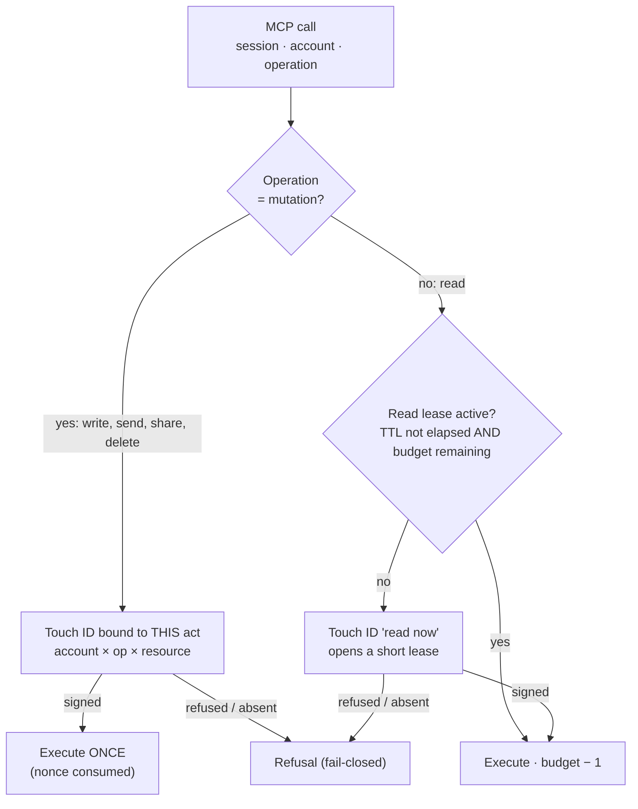
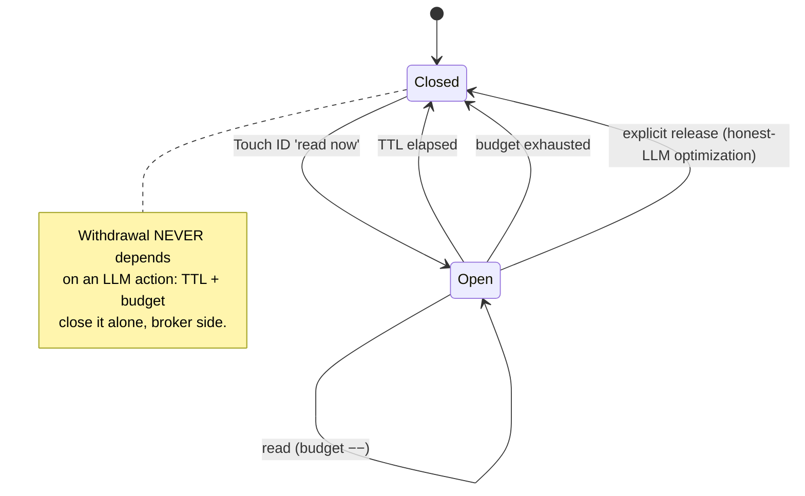

# ADR-0011 — Consent duration: short read lease + signed sensitive act, the minutes window removed (backlog item 20260911135931576)

**Date**: 2026-09-11
**Status**: proposed (scope: duration model; applies to `session_unlock` as well as to in-conversation mode)
**Deciders**: Thomas (maintainer), architect (this decision)

> **In plain terms** — A Touch ID no longer opens a door for 60 minutes. To **read**, it opens a **short lease** (a few requests, a few dozen seconds) that **closes by itself**. To **write, send or share**, it opens **nothing at all**: each sensitive act requires **its own** Touch ID, bound to that exact act. The minutes window disappears as a central mechanism. *The tool verifies, the human authorizes every externally visible effect, the LLM proposes.*

## Context

Per-session unlock ([ADR-0007](ADR-0007-per-session-rights.md), backlog item `0076` delivered) takes a **`minutes`** parameter (default 60, bounded 1–1440). One Touch ID, then the session accesses the account **freely** until expiry, **without re-validation** (`gateway/sessions.py:296` `session_unlock` → `unlocks[alias] = now + minutes*60`; `gateway/api.py:118` `_run` requires nothing beyond `is_session_unlocked`). The "elicitation in the conversation" mode reuses that same parameter.

Two complaints, settled by Thomas:

- **The duration is arbitrary.** Conversational usage is "I ask for one thing, it gets done, that's it" — not "keep the door open for an hour".
- **The window is an abuse window.** For N minutes, a hijacked LLM (prompt injection) chains operations within **all** the session's rights, **with no** new human action. The blast radius of an injection = everything the policy allows, for N minutes.

Structuring constraints:

- **The MCP server does not know when the LLM has finished answering.** The protocol carries no "one response" boundary. We therefore cannot rely on the LLM to close cleanly — a hijacked LLM will not cooperate.
- The consent mechanism already exists and **cryptographically** binds the action to the exact act: `run_elicitation_gate` (`gateway/elicitation.py:501`) signs a payload `action × alias × target × resource × nonce` (anti-replay, ADR-0005). We reuse it, we do not invent.
- ADR-0007 already sets the **read / write** asymmetry: the resource is **required for writes** (Drive), optional for reads. The duration must follow the same asymmetry.

## Decision

**Two duration regimes, depending on whether the operation is a read or a mutation. The tool → (operation, read|mutation) mapping is fixed at implementation, like ADR-0007's tool → (operation, resource) mapping.**

1. **Mutation (write, send, share, delete) = single-use signed act.** No window. Each sensitive act requires **its own** Touch ID, bound to the exact scope (account × operation × resource: the folder written, the file shared, the recipient). The signed receipt authorizes **exactly one** execution; the consumed nonce = the consumed act (`consume_nonce`, already in place). A second act, even an identical one, asks for a Touch ID again. This is the "card payment" model: you validate **at the moment you act**.

2. **Read = short lease, self-closing.** A "read now" Touch ID opens a **lease** on (session, account, read) bounded by **two limits, the first reached closes it**: a **short TTL** (default ~90 s) **AND** an **operation budget** (default ~20 reads). The lease covers the natural chain of a single request (list → open → open…) without re-validating at each object, but closes well before becoming an abuse window.

3. **Withdrawal NEVER depends on an LLM action.** Closing is **automatic** (TTL elapsed or budget exhausted), computed on the broker side at each call. An explicit release tool (`session_close` / end of lease) remains **possible as an option** — to shorten the lease when the LLM is honest — but it is an **optimization**, never the security boundary. A hijacked LLM that does not call it again gains nothing: the lease closes by itself.

4. **`minutes` removed as a central mechanism.** `session_unlock` and in-conversation mode no longer open a long window: they open the short **read lease**. The `minutes` parameter is **deprecated**: kept as input for compatibility, but **clamped to the lease ceiling** (a few minutes max, no longer 1440) — an old caller sees its abuse window bounded immediately, without breaking the API. Eventually, a hard removal.

5. **Rights (the *what*) remain defined by the policy / admin / project manifest** (*fail-closed* intersection, ADR-0007 §Decision 3). This ADR changes **only the timing** of consent (the *how long*), not the scope (backlog item `0108`) nor who triggers the popup (in-conversation backlog item).

### The single control point — `_run`

*Legend — the top diamond separates the two regimes: a mutation always goes through a Touch ID dedicated to the act (left branch, single use); a read reuses the short lease while it holds, otherwise opens a new one (right branch). Any refusal or missing action falls to the fail-closed refusal.*

### Read lease lifecycle

*Legend — the lease closes through one of three paths; only the first two (TTL, budget) are security guarantees, the third (release) is merely a shortcut when the LLM cooperates.*

## Anti-injection — what the transactional model really reduces (black on white)

- **Minutes window (before).** A single Touch ID → a hijacked LLM chains, for N minutes, **any** operation the policy allows — reads **and** mutations, with no other action. Blast radius: wide and lasting.
- **Read lease (after).** An injection landing during a lease can only do **reads**, only for a short TTL **and** within a limited budget, and the lease **closes by itself** — the LLM cannot extend it. The human action meant "read now", not "read for an hour".
- **Signed sensitive act (after).** This is the real gain. Any **externally visible** effect — send, share, overwrite, delete — requires a Touch ID **bound to that precise act** (this recipient, this folder, this file). An injection cannot trigger **any** external effect without the human **physically** approving **that act**. We move from "inside a trust window" to "every effect is carried".
- **Honest limit, unchanged.** Without a vault (backlog item `0003`), the model remains **cooperative**: an agent with a shell can edit `.sessions/` or call bare `gws`. The transactional model **hardens** the cooperative model (reduces the time surface and imposes one action per effect); it does not make it cryptographically tight.

## Options considered

**How to bound "the request in progress"**

| Option | Simplicity | Depends on the LLM? | Bounds abuse | Verdict |
|---|---|---|---|---|
| **Short lease: TTL AND op budget, self-closing** | medium | no | time **and** volume | **chosen** |
| Short TTL alone | high | no | time only (burst possible) | rejected — a burst exhausts the TTL |
| Operation counter alone | high | no | volume only ("dormant" lease for a long time) | rejected — no time bound |
| Explicit release (`session_close`) as the boundary | high | **yes** | none if the LLM is hijacked | rejected as a boundary — **kept as** an optimization option |

**Read vs write regime**: *two regimes* (**chosen** — read = lease, mutation = signed act; follows ADR-0007's resource asymmetry) vs *a single regime* (rejected — either validation fatigue on reads, or an abuse window on writes).

**Fate of `minutes`**: *deprecated + clamped to the lease ceiling* (**chosen** — bounds abuse without breaking the API) vs *immediate hard removal* (rejected for this milestone — breaks `session_unlock`, the admin, and the tests all at once) vs *keep as-is as an override* (rejected — reintroduces the abuse window).

## Consequences

**Easier**: the human action matches the intent ("act now"); the blast radius of an injection collapses (time + volume bounded, every external effect carried); the audit becomes readable (a signed receipt **per** sensitive act, not a single receipt covering an hour of activity).

**Harder**: more Touch IDs overall (accepted — it's the price of "one action per effect"); a clean, fail-closed **tool → read|mutation mapping** is needed (an unclassified tool = treated as a mutation, the strictest); the lease adds a bit of state to the session registry (TTL + counter per (session, account)); the default dial (~90 s / ~20 ops) will need to be **calibrated through use** so as not to trivialize the action.

**To revisit**: the numeric defaults (TTL, budget) after real usage; whether to add the release tool; an **allowlist of sensitive accounts** where even reads become a signed act (to cross-check with the 2nd step of the in-conversation backlog item); the **hard** removal of `minutes` once callers are migrated.

## Fallback (fail-closed) & limits

- Touch ID refused, biometrics unavailable, token absent/expired → **refusal** (never access by default) — unchanged vs ADR-0007.
- **Tool unclassified** read|mutation → treated as a **mutation** (signed act): the strictest regime by default.
- Lease expired (TTL) or budget exhausted **during** a request → the next read **reopens** a lease (new Touch ID); no silent access beyond.
- The release tool, if added, **can never** extend a right — only close earlier. An LLM that does not call it gains no access.

## References

- Backlog items (in the repository): `features/20260911135931576_deverrouillage-transactionnel-vs-minutes.md` (this one), `features/20260910194019668_elicitation-in-conversation-opt-in.md`, `features/0108-session-demande-sous-ensemble-droits-compte.md`, `features/0082-droits-par-session.md`, `features/0003-vault-credentials-hors-perimetre-agent.md`
- ADRs: [ADR-0007](ADR-0007-per-session-rights.md) (per-session rights foundation), [ADR-0005](ADR-0005-signed-elicitation-v2.md) (signed elicitation reused)
- Code: `gateway/sessions.py` (`session_unlock:296`, `is_session_unlocked:454`, `SessionState:74`), `gateway/api.py` (`_run:88`, lock gate `:118`, `access_request:895`, `session_unlock_in_conversation:1121`), `gateway/elicitation.py` (`run_elicitation_gate:501`, `consume_nonce:229`, `build_payload:177`)
- Threat: `docs/threat-model.md`, `SECURITY.md`
