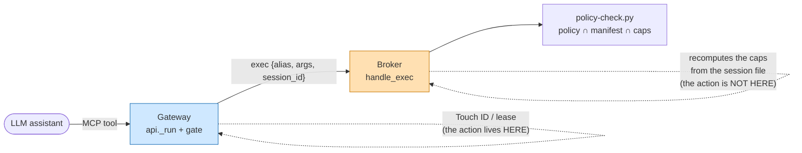
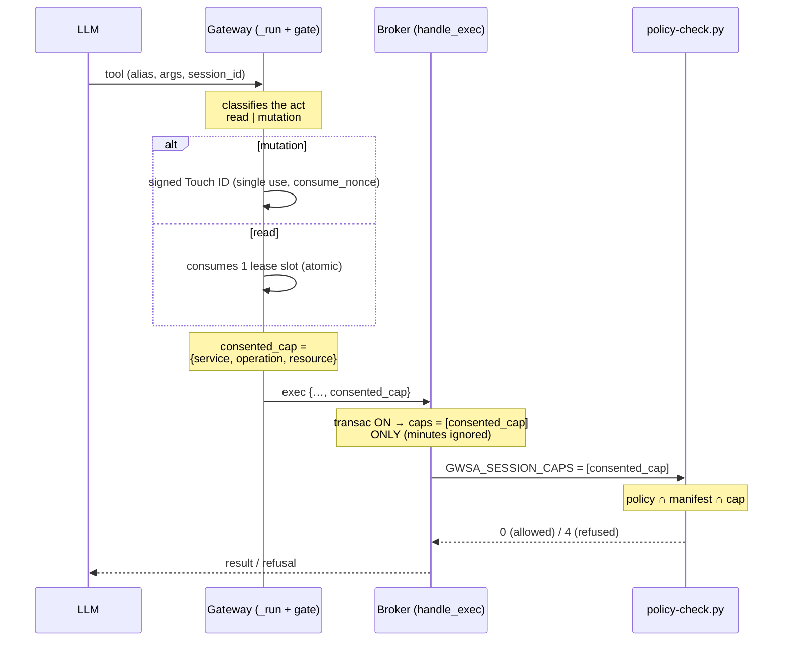
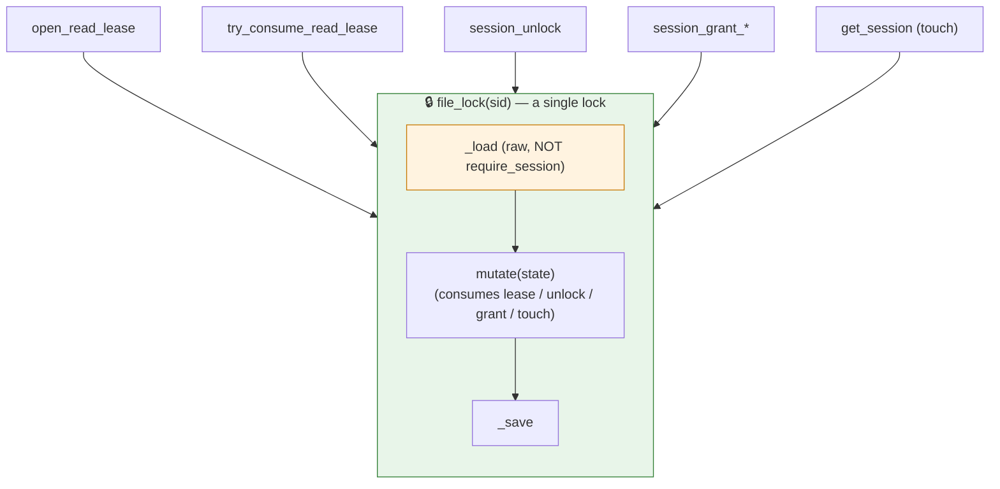
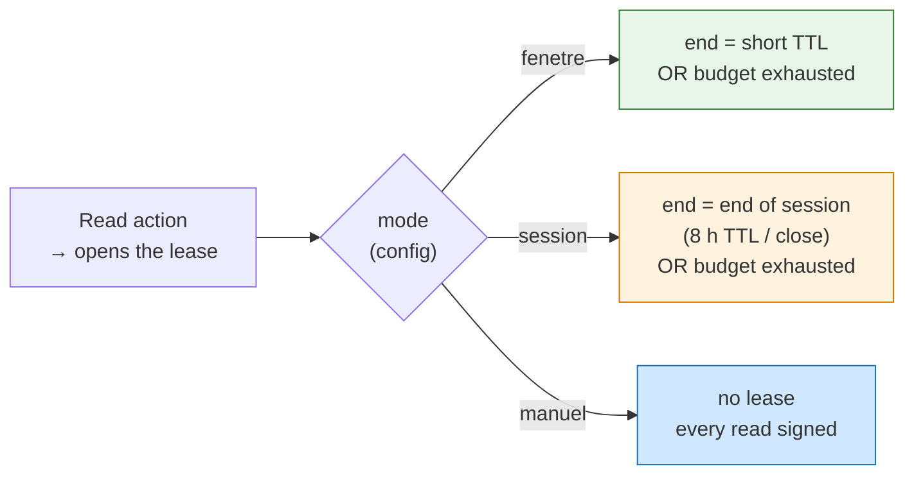

# ADR-0012 — Transactional consent: propagate the action all the way to the policy (refinement of ADR-0011)

**Date**: 2026-09-12
**Status**: proposed (refines ADR-0011 on 3 implementation points + 1 product setting — lease lifetime; opt-in feature, OFF by default)
**Deciders**: Thomas (maintainer)
**Refines**: [ADR-0011](ADR-0011-transactional-consent-per-session.md) · builds on [ADR-0007](ADR-0007-per-session-rights.md), [ADR-0005](ADR-0005-signed-elicitation-v2.md)

> **TL;DR** — ADR-0011 set out the *what* of transactional consent (read lease, single-use signed mutation act, withdrawal never LLM-dependent). Three rounds of Codex review showed that the *how* was leaking through three holes: the action succeeded in the **gateway** but the **broker** refused anyway (it recomputed empty capabilities), concurrent session writes overwrote each other, and the signature did not bind the act's real arguments. This ADR settles all three **upstream** so a single clean implementation replaces the patches: (1) the consented capability **travels in the call** and becomes the single source on the broker side; (2) **all** session read-modify-writes go through **one lock**; (3) consequential arguments enter the **signed payload** through an **explicit table**, unmapped act = refusal. A **product setting** is added (Zone 4): the **lease lifetime** becomes a configurable mode — **manual (default: one right, one action)**, short window, or bound to the session — chosen in config/admin, without ever loosening the signature of mutations. *The tool verifies, the human authorizes, the LLM proposes.*

---

## Context

The action and the enforcement of the right live in **two processes** that talk only through a JSON socket:

*Figure 1 — The action succeeds in blue (gateway), but the access decision is made in orange (broker) from the session file, which the action did not update. Hence the hole: consent obtained, access refused.*

Concretely, the three recurring P1 findings from Codex (PR #147):

1. **Consent does not reach the policy.** `_require_access` (broker) no longer requires `is_session_unlocked` in transactional mode, but `handle_exec` still computes the caps from `is_session_unlocked`/`active_capabilities` → it sends an **empty** `GWSA_SESSION_CAPS` to `policy-check.py`, which then refuses **every** operation (deny-all on an empty set, ADR-0007 §3). A profile with a `policy.json` stays blocked even after a successful transactional Touch ID.
2. **Session writes clobber each other.** A per-session lock protects `try_consume_read_lease` and the `get_session` touch, but `open_read_lease`, `session_unlock`, `session_grant_*` load through `require_session` then save **outside the lock** → a concurrent save restores a stale lease budget.
3. **The signature does not bind the real act.** The payload signs `service:resources:method` + a single resource. Two `drive permissions create` on the same file (different recipient/role) sign identically; a permission deletion omits `permissionId`; a Gmail draft omits recipient/subject. The human approves without seeing the consequence.

**Choice: a new ADR rather than an amendment to ADR-0011.** ADR-0011 is *accepted* and lives on another unmerged branch. These three points are **new decisions, with alternatives**, born from review — tracing them separately preserves the thread "why the clean implementation has this shape" and avoids a cross-branch conflict. ADR-0012 refines, does not replace.

---

## Decision — Zone 1: the consented capability travels in the call

**Decision.** After a successful action, the gateway computes the **exact** capability of the act — `{service, operation, resource}` — and attaches it to the broker's exec request (new field `consented_cap`). In transactional mode, the broker uses **only** this capability as session caps (`session_full_access` forced to `False`, `active_capabilities`/unlock-minutes ignored) and passes it to `policy-check.py`. The ADR-0007 intersection therefore applies **unchanged**: `account policy ∩ project manifest ∩ {consented_cap}`. The capability is **never persisted**; it is **single-use by construction** (it lives for the duration of one call).

*Figure 2 — The action (blue, gateway) produces a capability that descends in the call all the way to the policy (orange, broker). No `consented_cap` → empty caps → refusal. The capability can never exceed policy or manifest: the action opens at most the requested act, bounded by the ADR-0007 intersection.*

**Alternatives rejected.**
- *Persist a single-use ephemeral `Capability` in the session file*, which `active_capabilities` rereads. Rejected: reintroduces a **window** (the cap must survive the socket round trip → a 2nd identical act would find it active), adds **persistent mutation state** + a *consume-after-use* (a crash between grant and consumption = dangling cap), and creates **double bookkeeping** with the already-persisted lease.
- *Re-verify the signature/nonce in the broker.* Rejected: the nonce is already consumed upstream (ADR-0005), re-verifying ECDSA on the hot path is redundant and gains nothing in the cooperative loopback+token model.

**Consequences.** The control point becomes **single** again: the gateway decides, the broker applies the same decision, no more diverging recomputation. The socket protocol gains a field. The minutes mechanism is entirely short-circuited in transactional mode (consistent with "transactional *replaces* minutes").

**Fail-closed fallback.** Field absent/unreadable → empty caps → **deny-all** (ADR-0007 §3 behavior unchanged). The broker is reachable only through the gateway (loopback + token), which has already carried the action; it never fabricates a cap itself.

**Honesty of the model.** The broker trusts the gateway's assertion — this is **already** ADR-0007's posture (without a vault, a bare shell bypasses). Possible hardening (batch 5, outside the POC): the gateway attaches the **receipt/nonce id**, the broker **confirms consumption** before honoring the cap → the cap is then bound to the signed proof, not to a mere field.

---

## Decision — Zone 2: one lock for all session RMWs

**Decision.** All read-modify-writes of a single session file go through **one lock per session** (`_lock_path(sid)`), via a private helper `_with_locked_session(sid, mutate)` that **loads raw** (`_load`), applies the mutation, `touch()` then `_save` — **all under the lock**. Internal functions **never** call `require_session`/`get_session` under the lock: `file_lock` is a **non-reentrant** `flock` (a 2nd acquisition in the same process **blocks**). Routed through the helper: `get_session` (touch), `open_read_lease`, `session_unlock`, `session_grant_drive`, `session_grant_capability`, `try_consume_read_lease`.

*Figure 3 — All session write entry points converge on the same lock (green). Inside, we load raw (orange) — never `require_session`, which would retake the lock and deadlock. A concurrent save can no longer restore a stale budget.*

**Alternative rejected.** *Isolate the volatile lease state in a separate `<sid>.lease.json` file, with its own lock.* Attractive for the hot path (the lease no longer contends with grant/unlock), but: two files, two locks, **fragmented source of truth**, cross-TTL consistency (session expiry must also clean up the lease). Over-engineering for a POC (**YAGNI**). The cost of the single lock = **one uncontended flock acquisition per call** — negligible next to the `gws` exec (socket + subprocess).

**Consequences.** Strict serialization of session mutations, a single mechanism to reason about and test. The hot path (read) pays one more acquisition, with no real contention.

**Fail-closed fallback.** Lock acquisition failure or timeout → **refusal**, never an unserialized RMW.

---

## Decision — Zone 3: bind consequential arguments to the signed payload

**Decision.** An **explicit table** `(service, method) → consequential arguments` (modeled on ADR-0007's tool→resource mapping `_OPERAND_PARAM`/`categorize.py`) extracts, from the **same parsed flags** (`parse_json_flag`), a set of **normalized and canonical** arguments (sorted keys, ordered lists). These arguments enter a `bound_args` object of the **signed payload** (ADR-0005) **and** the Touch ID prompt (Python `prompt_from_payload` **and** Swift `promptText`). **Unmapped mutating act → refusal**: we neither sign nor display what we cannot describe.

Initial table (mutation surface actually exposed by the MCP tools):

| Service · act | `bound_args` signed & displayed |
|---|---|
| `drive permissions create` | `fileId`, `type`, `role`, `grantee` (email/domain) |
| `drive permissions delete` | `fileId`, `permissionId` |
| `drive files delete` / trash | `fileId` |
| `drive files update` | `fileId`, modified fields |
| `gmail drafts create` | `to[]` (sorted), `cc[]`, `subject` |
| *any other mutating act* | **∅ → refusal (fail-closed)** |

*Reading: the lease deliberately stays coarse (TTL + budget), so **no** `bound_args` for reads — only mutations bind their arguments.*

**Alternatives rejected.**
- *Pack role/grantee into the existing `target` string* (zero schema change). Rejected: **delimiter injection** — a `fileId`/email containing the separator forges or makes the payload ambiguous; unreadable rendering. The canonicalized structured object is **injection-safe**.
- *Heuristic "take all the `--flags`"*. Rejected: **attackable surface**, non-deterministic, unreadable prompt. Like ADR-0007, we want an **explicit mapping**, never a guess.

**Consequences.** The receipt and the Touch ID dialog say **who** receives **what** and at **which role**: the human approves the real consequence. ADR-0005's canonical payload gains a `bound_args` field — **a content bump to replicate on the Swift signer side**: the canonical bytes (sorted keys) must be **identical** in Python/Swift.

**Fail-closed fallback.** `consequential_args()` returns `None` (act outside the table) → the gate **refuses**. Expected resource/argument missing or ambiguous → refusal (never a "blank" signed act).

---

## Decision — Zone 4: lease lifetime (configurable mode)

**Decision.** The end bound of the read lease becomes an **explicit mode**, chosen in configuration (file + admin interface), read via `env("TRANSACTIONAL_LEASE_MODE")`. Three values:

- `manuel` (**default**, Thomas's decision 2026-09-17) — no lease: **every read** goes through a signed act. **One right, one action**: the LLM can never do more than the act the human has just approved, regardless of time. The strictest, the best anti-injection posture.
- `fenetre` — the lease lives for a **short window** (TTL) **and** a **budget** of reads. It closes at the first of the two reached. Comfortable grouping (several reads under one action), explicit opt-in.
- `session` — the lease lives **as long as the session** — its inactivity TTL, currently 8 h (ADR-0007) — or until `mag session close`. It is stored in the session file, so it **disappears with it**. The **budget** stays active as a safety net: end of session **or** N reads, whichever comes first.

*Choice of the manual default (2026-09-17): Thomas favors "one right = one action" — the bound is the **act**, not time. `fenetre`/`session` remain available for those who prefer read comfort, at the price of a notch of safety; to watch on the validation-fatigue side (one action per read can trivialize Touch ID).*

The mode changes **only the lease's end bound**. It touches neither the ADR-0007 intersection (Zone 1), nor the lock (Zone 2), nor the signature of mutations (Zone 3). **Mutations remain single-use signed in every mode** — the mode never loosens writing, only read comfort.

*Figure 4 — Same read action, three end bounds depending on the mode. `fenetre` (green) is the strictest of the lease modes; `session` (orange) the most comfortable, bounded by the budget; `manuel` (blue) removes the lease and re-signs every read.*

**Why this is not "closes on archive".** The gateway receives **no signal** when a conversation closes. ADR-0007 §Decision 5 settled it: tokens are *bearer*, Desktop shares **a single** MCP connection for all conversations, and the MCP protocol provides **no conversation identifier**. The server therefore cannot know that a given chat was archived. The only observable end of life is the **TTL** or an **explicit close**. The `session` mode aligns with what the gateway can actually see.

**Alternatives rejected.**
- *Tie the lease to the conversation's archiving* (the ergonomic dream: "closes when I leave the chat"). Rejected: **not observable** on the server side (see above). Wiring it would assume **the client** calls `close_session` at the end of the conversation — an app-side hook that does not exist today. To keep as a **client** evolution, outside the gateway.
- *Hard-code a single mode.* Rejected: acceptable friction depends on usage — a massive read run does not want to re-sign every 90 s, an occasional access wants the shortest window. The dial must be **config**, not code.

**Consequences.** One more config notch, read by `env()` and exposed in the admin (policy / transactional panel). The `session` mode is **more comfortable** but **less strict**: a lease that lives 8 h resembles the old "unlocked for the day" that ADR-0011 was replacing. The **read budget** is what keeps it bounded. A trade-off to accept on the product side (see human decision #1).

**Fail-closed fallback.** Mode value absent, unreadable or unknown → `manuel` (the strictest — one action per act). Only an **explicit** `fenetre`/`session` opt-in loosens reading; never a permissive default.

---

## Implementation plan (by batch)

Chosen order: clean up the base (lock) **before** plugging propagation into it, signature last since it alone touches Swift.

| Batch | Content | How to test |
|---|---|---|
| **1 — Zone 2** | `_with_locked_session` + routing of **all** RMWs; removes saves outside the lock. Pure internal refactor. | **Hermetic.** Concurrency tests (consume ↔ save race), flag-OFF non-regression. |
| **1 bis — Zone 4** | `TRANSACTIONAL_LEASE_MODE` mode (`fenetre`/`session`/`manuel`) read via `env()`; lease end bound per mode; budget kept as a safety net. Written through batch 1's lock. | **Hermetic.** One test per mode: `fenetre` expires at TTL/budget, `session` survives the short TTL but dies at `close_session`, `manuel` opens no lease. `fenetre` fallback on unknown value; flag-OFF non-regression. |
| **2 — Zone 1** | `consented_cap` field gateway→broker; broker: with transac ON, `caps = [consented_cap]` **only**; `policy-check.py` unchanged. | **Hermetic.** Transac ON + restrictive `policy.json` + `GWSA_ELICITATION_MOCK=1`: consented act passes, non-consented act = deny. No real Touch ID. |
| **3 — Zone 3 (Python)** | `consequential_args` table + `bound_args` in the payload + Python prompt rendering. | **Hermetic.** *Canonical bytes* test via the HMAC mock path; unmapped act → refusal. |
| **4 — Zone 3 (Swift) + live** | Swift prompt rendering + Python/Swift **canonical bytes parity**; Touch ID dialog showing op + account + args; 2-conversation test. | **Non-hermetic** — requires the real broker + Swift + Touch ID (manual test `tests/manuels/`). |
| **5 — Hardening (optional, outside the POC)** | Broker re-binds the cap to the signed receipt (confirms the consumed nonce) before honoring `consented_cap`. | Hermetic on the nonce side; posture decision (see below). |

**Invariants preserved at every batch**: opt-in OFF by default (flag `.transactional-consent` / `GWSA_TRANSACTIONAL_CONSENT`); never restore the minutes window; reuse of `consume_nonce`, `categorize`, `parse_json_flag`, ADR-0007 mapping.

---

## What remains a **human** decision (value, not technical)

1. **Default lease settings** — default mode **settled: `manuel`** (2026-09-17, "one right one action"). The TTL/budget values (currently 90 s / 20) only matter if `fenetre`/`session` is enabled; to calibrate the day read comfort is wanted.
2. **`bound_args` scope for Gmail**: sign the draft **body** (or its hash) or only `to`/`cc`/`subject`? Proposal: `to`/`cc`/`subject` (no tool *sends*; the body is large and volatile). A fidelity ⇄ ergonomics trade-off.
3. **Do batch 5 in this POC?** Bind the cap to the signed receipt on the broker side, or accept the cooperative model (loopback + token) like the rest of ADR-0007. A **security posture decision**, not an implementation one.

---

## References

- ADRs: [ADR-0011](ADR-0011-transactional-consent-per-session.md) (transactional model — refined here), [ADR-0007](ADR-0007-per-session-rights.md) (fail-closed intersection policy ∩ manifest ∩ caps), [ADR-0005](ADR-0005-signed-elicitation-v2.md) (signed payload, `consume_nonce`).
- Backlog item: `features/20260911135931576_consentement-transactionnel.md` (to be created/updated if absent).
- Code: `gateway/api.py` (`_run`, `_transactional_gate`, `_classify_operation`), `gateway/broker_server.py` (`handle_exec`, `_require_access`, `check_policy`), `gateway/sessions.py` (lock, lease, lifetime mode), `gateway/config.py` (`env` — reading `TRANSACTIONAL_LEASE_MODE`), `gateway/categorize.py` (`operand_resource`, `_OPERAND_PARAM` — model for the zone 3 table), `scripts/policy-check.py` (`check_session_caps`, `_session_cap_allows`), `scripts/elicitation-sign.swift` (`promptText`), `gateway/elicitation.py` (`prompt_from_payload`, `run_elicitation_gate`).
- Threat: `docs/threat-model.md`, `SECURITY.md`.
