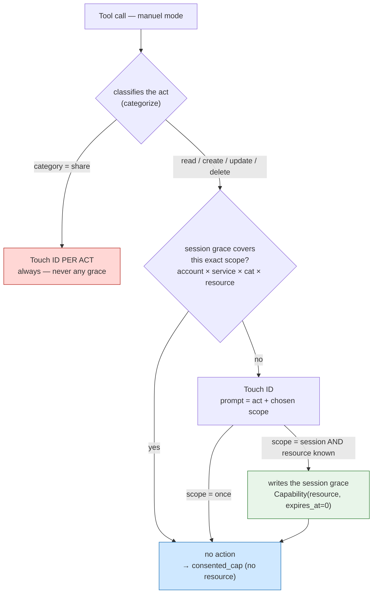
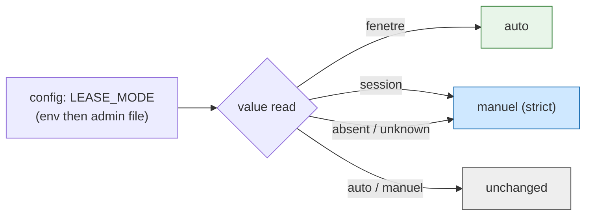

# ADR-0013 — Consent "once / for the session": scope becomes a per-act choice (refinement of ADR-0012 Zone 4)

**Date**: 2026-09-20
**Status**: proposed (refines ADR-0012 Zone 4; opt-in feature, OFF by default)
**Deciders**: Thomas (maintainer)
**Refines**: [ADR-0012](ADR-0012-transactional-consent-propagation.md) · builds on [ADR-0011](ADR-0011-transactional-consent-per-session.md), [ADR-0007](ADR-0007-per-session-rights.md), [ADR-0005](ADR-0005-signed-elicitation-v2.md)

> **In plain terms** — Transactional consent works (delivered #149), but Claude Code's action is missing: at the moment of authorizing, saying "once" or "for the whole session". This ADR adds it **with no new mechanism**: the "session" grace reuses the existing session capabilities with a **zero time bound** (a convention already in place for the read lease), it is **scoped to the exact folder**, **resolved on the gateway side** (the broker does not change), and **sharing is never eligible**. ADR-0012's three duration modes become **two modes** — `manuel` (default) and `auto` (ex-`fenetre`) —, the global `session` mode disappears, and durations (session TTL, auto window) become admin settings. *The tool verifies, the human authorizes, the LLM proposes.*

---

## Context

The manual test of #149 (gma-tx, real accounts) validated the transactional core: refusal without a session, double consent (chat + Touch ID), read and write signed per act. It revealed one gap and two blemishes:

1. **No "for the session".** In `manuel`, repeating exactly the same act (writing to the same folder) asks for a Touch ID every time. What is missing is "accept this scope for the rest of the session", Claude Code's per-act choice.
2. **Unwanted durations.** `unlock` still arms writes through a minutes window, while the transactional model wants none.
3. **Mode not settable from the admin.** The mode is chosen by env/file; a selector is needed, like Claude Code's mode menu.

ADR-0012 Zone 4 had set three lease-duration modes (`manuel`/`fenetre`/`session`). The test shows that the right dial is not *the lease duration* but *the scope of a consent*, chosen **act by act**. This ADR therefore replaces Zone 4.

*Figure 1 — The decision path in `manuel` mode. Red: sharing is always signed per act, never covered by a grace. Blue: the call is authorized for that single call (cap with no resource, as today). Green: a folder-scoped grace is written to the session; an act of the same scope will go back through the "yes" branch with no action.*

---

## Decision 1 — The "session" grace reuses capabilities, with a zero time bound

**Decision.** "For the session" writes a `Capability(account, service, operation, resource, expires_at=0.0)` into the session's `capabilities` list. The value **`expires_at <= 0` encodes "no time bound of its own"**: the grace lives as long as the session file exists, and disappears with it (inactivity TTL or `close_session`). This is the **same sentinel convention as `ReadLease`** — a single idea to remember across the whole module. `Capability.active()` becomes `expires_at <= 0.0 or expires_at > t` (mirror of `ReadLease.active`).

**Alternative rejected.** A separate `session_grants` collection, with its own lock. Attractive for isolation, but: fragmented source of truth, duplication of parent→child inheritance (`_effective_capabilities`, `create_child_session`), of the `list_sessions` rendering, and cross-TTL consistency. Over-engineering for a POC (YAGNI) — same reasoning as the "two files" alternative rejected in ADR-0012 Zone 2.

**Consequences.** Zero new structure; sub-session inheritance, snapshot and purge already work. `list_sessions` must display "lives with the session" for a sentinel cap (not a negative `minutes_left`). The public `session_grant_capability` grant (human-driven, with a TTL) remains unchanged: only the transactional path produces the sentinel.

**Fail-closed fallback.** Cap unreadable/absent → not covered → action asked again. The grace never outlives its session file.

---

## Decision 2 — Scope = the exact resource (the folder), on the grace side only

**Decision.** The grace is scoped to the quadruplet `(account=alias, service, operation=category, resource)`, where `resource` is the real operand derived by `operand_resource()` (already the source of truth for Drive authorization): destination `parents` for `create`, `fileId` for `update`/`delete`. Matching reuses **`session_has_capability()` without modification** — a cap with a resource covers only that resource, a cap without a resource covers the whole service×operation.

**Structuring point.** The resource lives **in the stored grace** (for gateway matching), **not in the `consented_cap`** that descends to the broker: the latter stays **without a resource**, as since ADR-0012 Zone 1. Scoping is applied upstream; the broker keeps `policy ∩ manifest ∩ cap` intact.

**Alternative rejected.** Putting the resource in the `consented_cap` that travels. Rejected: reopens the Codex #147 P1 hole (a scoped cap that matches no policy-check path → re-deny), deliberately closed by ADR-0012.

**Consequences.** "Once" stores nothing (Touch ID per act, as today); only "for the session" writes a grace. A `create` scopes the **destination folder** (the backlog item's demo); an `update`/`delete` scopes the **precise file** (more granular, safer).

**Fail-closed fallback.** Write with no derivable resource (`operand_resource == ""`, ambiguous) → grace not written, "session" falls back to "once". Never a write grace at service level.

---

## Decision 3 — Resolution on the gateway side; the broker does not change

**Decision.** In `manuel` mode, `_transactional_gate` (gateway) resolves the grace before any action: (1) classify, (2) sharing safeguard, (3) `session_has_capability(...)` → if covered, no Touch ID, return `_consented_cap(service, category)` without a resource, (4) otherwise Touch ID then, on success and if scope=session and eligible, write the grace. The broker still receives a `consented_cap` without a resource: `handle_exec` is **unchanged**.

The "once / for the session" choice is a **signed scope field** (`grant_scope ∈ {once, session}`, default `once`), threaded at the call level through `_run`, placed in the **signed payload** and in the **Touch ID prompt text**. The LLM relays the choice expressed in the chat; **the human confirms it by reading the prompt and placing their finger**. ADR-0007's cooperative posture is unchanged: the LLM proposes, the human authorizes.

**The edge is wired (batch 6).** `grant_scope` is exposed in the schema of **NON-sharing** mutation MCP tools (`drive_create`, `drive_update`, `drive_copy`, `drive_upload`, `gmail_draft_create` — enum `once`/`session`, default `once`), extracted at dispatch and relayed to the corresponding api function and then `_run`. **Never** on `drive_permissions_create`/`drive_permissions_delete` (Decision 4 safeguard: sharing has no scope parameter at the edge, not just at the gate). This is the parameter the LLM fills in when the user says "for the session" in the chat; the native two-button popup ("Once" / "For the session"), which would offer the same choice directly in the Touch ID action, remains the future ergonomic goal — prompt *text* parity Python↔Swift already exists (batch 5), but not yet the dedicated button.

**Alternative rejected.** Having the broker recompute the grace from the session file. Rejected: reintroduces the diverging decision point that ADR-0012 Zone 1 removed ("the gateway decides, the broker applies the same decision").

**Consequences.** Two separate lock acquisitions (grace read, then write) — acceptable because the write is idempotent (deduplicated by quadruplet), with no counter to decrement: no TOCTOU like the lease budget. A delegated sub-session is not allowed to write a grace (only the root grants capabilities, ADR-0007): it is therefore excluded from the grace (lookup and write), and the grace write is in any case wrapped in a safety net — a failure never makes the already-approved act fail (P1 fix, batch 6).

**Fail-closed fallback.** Scope absent/unknown → `once`. Action refused → `GatewayError(code="locked")`, never access. Unsigned scope field ignored: the scope has an effect only through the signed payload.

---

## Decision 4 — Outgoing sharing is never eligible for "for the session"

**Decision.** The grace is consulted and written only for `category ∈ {read, create, update, delete}` — an **allowlist**. `category == "share"` (permissions/acl/members create/delete) **and any unknown category (`None`)** are excluded → **Touch ID per act, always**. Two layers: at lookup (a sharing grace, even if present, is never honored) and at write (no sharing grace is ever written). The eligibility branch is the first one of the manual path, computed from `categorize()` (shared source of truth).

**Alternative rejected.** Exclude by denylist (`category != "share"`). Rejected: a future unclassified category would slip through. The allowlist is fail-closed by construction.

**Consequences.** Sharing — the point where a lingering access would be most dangerous — remains a single-use signed act, aligned with "irreversible/outgoing always signed".

**Fail-closed fallback.** Non-allowlisted category → no path to the grace, whatever the requested `scope`.

---

## Decision 5 — Two modes: `manuel` (default) and `auto`

**Decision.** `LEASE_MODES = ("auto", "manuel")`. `manuel` = per act with a once/session choice; `auto` (ex-`fenetre`) = grouped read lease, write per act, **no session grace on writes**. The global `session` mode is removed. Session graces are **consulted and created only in `manuel` mode**: switching to `auto` ignores them (fail-closed, as `_lease_usable` already neutralizes a residual `session` lease). Compatibility of legacy values:

*Figure 2 — Only two modes. Legacy values fall back: `fenetre → auto` (green), `session → manuel` (blue, the strictest), unknown → `manuel`. A loosening that was not re-chosen is never inherited.*

**Alternative rejected.** `session → auto`. Rejected: would silently inherit a read loosening; contrary to "only an explicit opt-in loosens".

**Fail-closed fallback.** Mode absent/unreadable/unknown → `manuel`.

---

## Decision 6 — Durations become settings

**Decision.** The session inactivity TTL (`SESSION_TTL_SEC`, default 8 h) and the `auto` mode window (`READ_LEASE_TTL_SEC`, `READ_LEASE_BUDGET`) are already read via `env()`; we add their **admin selector** (persisted in a marker file, like the mode). **Minutes-based unlock** (`session_unlock`) is **removed when transactional is active**: it refuses and points to "for the session". Flag OFF: `unlocks`/`minutes` **strictly unchanged** (non-regression).

**Alternative rejected.** Delete `unlocks`/`minutes`. Rejected: breaks the flag-OFF path and the soft migration.

**Fail-closed fallback.** Unreadable settings → defaults (8 h, short window). Unknown mode → `manuel`.

---

## Fail-closed fallback (summary)

- Scope absent/unknown → `once`.
- Write with no identifiable resource → no grace, "session" → "once".
- Category `share` or unknown → never a grace, always signed.
- Mode unknown/unreadable → `manuel`; graces ignored outside `manuel`.
- Action refused, cap unreadable, lock failing → refusal, never access.
- Mutations remain **single-use signed in every mode** — the grace never loosens writing beyond the exact scope the human consented to.

---

## Implementation plan (by batch)

| Batch | Content | How to test |
|---|---|---|
| **1** | `Capability.active()` accepts the sentinel `expires_at <= 0`; session-lived grant helper (`hours=0` → `expires_at=0`); `list_sessions` renders "lives with the session". | **Hermetic.** Sentinel cap active as long as the session lives, absent after `close_session`; non-regression of TTL caps. |
| **2** | `transactional_lease_mode()` → `("auto","manuel")` + compat mapping; `open_read_lease`/`_lease_usable` rename `fenetre→auto`; graces consulted only in `manuel`. | **Hermetic.** `fenetre→auto`, `session→manuel`, unknown→manuel; residual `session` lease neutralized. |
| **3** | Signed scope `grant_scope` in `build_payload` + `prompt_from_payload` (Python); threaded through `_run` → `_transactional_gate`. | **Hermetic.** Canonical payload bytes with/without `grant_scope` (HMAC mock); prompt displays the scope. |
| **4** | Core `_transactional_gate`: sharing safeguard (allowlist) → grace lookup → action → grace write if `session` + eligible + resource. | **Hermetic.** 2nd act same folder passes without action; different folder asks again; sharing asks again even after "session"; write without resource → "once". |
| **5** | Admin: mode selector (`auto`/`manuel`) + session TTL / auto window settings; removal of `session_unlock` in transactional; Swift prompt parity + manual test `tests/manuels/`. | **Hermetic** (admin endpoints, `session_unlock` refusal in transac, flag-OFF non-regression) **+ non-hermetic** (Swift + real Touch ID, two conversations). |
| **6** | The last thread: `grant_scope` exposed in the schema + dispatch of the 5 non-sharing mutation MCP tools (never on sharing); P1 fix for delegated sub-session (grace never written by a child, write failure never fatal to the act); P2 fix admin durations refuse `0`; unknown category already excluded by the allowlist (Decision 4), tested explicitly. | **Hermetic.** MCP schema/dispatch, end to end via `drive_create` (same folder without action, other folder asks again), delegated sub-session + scope=session (act passes, no grace, no exception), unknown category never eligible, CLI refuses `0`. |

**Exact files per batch.**

- **Batch 1**: `gateway/sessions.py` (`Capability.active`; new helper next to `session_grant_capability`; `list_sessions` caps_live). Test: `scripts/test.sh` (Python heredoc, `GWSA_ELICITATION_MOCK=1`).
- **Batch 2**: `gateway/sessions.py` (`LEASE_MODES`, `transactional_lease_mode`, `open_read_lease`, `_lease_usable`). Test: `scripts/test.sh`.
- **Batch 3**: `gateway/elicitation.py` (`build_payload`, `prompt_from_payload`); `gateway/api.py` (`_run` signature/threading). Test: `scripts/test.sh` (canonical bytes).
- **Batch 4**: `gateway/api.py` (`_transactional_gate`) — this is the central batch. Test: `scripts/test.sh` (the 4 acceptance criteria).
- **Batch 5**: `admin/server.js`, `admin/index.html` (selector + settings); `gateway/sessions.py` (`session_unlock`: refusal in transac); `scripts/elicitation-sign.swift` (`promptText`: scope parity); `tests/manuels/`.
- **Batch 6**: `gateway/mcp_server.py` (`_GRANT_SCOPE_PROPERTY`, schema + `DISPATCH` of the 5 non-sharing mutation tools); `gateway/api.py` (`drive_create`/`drive_update`/`drive_copy`/`drive_upload`/`gmail_create_draft` accept `grant_scope` and relay it to `_run`; `_transactional_gate`: `_is_delegated_session`, guard (a) eligibility, guard (b) protected grace write); `bin/mag` (`_tx_set_int`: refuses `0`). Test: `scripts/test.sh` ("ADR-0013 batch 6" section).

---

## Invariants preserved at every batch

- **Opt-in, OFF by default** (`.transactional-consent` / `MAG_/GWSA_TRANSACTIONAL_CONSENT`). Flag OFF = behavior as before, bit for bit.
- **Mutations always single-use signed** (`consume_nonce`) — the grace covers re-authorization of the **same exact scope**, never a loosening of the signature.
- **ADR-0007 intersection** `account policy ∩ project manifest ∩ caps` unchanged; the broker keeps `consented_cap` without a resource.
- **Single session lock (ADR-0012 Zone 2)**: every RMW goes through `_with_locked_session`; never `require_session` under the lock.
- **Sharing / outgoing always signed per act.**
- Reuse of `consume_nonce`, `categorize`, `operand_resource`, `session_has_capability`, the ADR-0007 mapping — no duplicated source of truth.

---

## References

- ADRs: [ADR-0012](ADR-0012-transactional-consent-propagation.md) (Zone 4 replaced here), [ADR-0011](ADR-0011-transactional-consent-per-session.md), [ADR-0007](ADR-0007-per-session-rights.md), [ADR-0005](ADR-0005-signed-elicitation-v2.md).
- Backlog item: `features/20260920141424574_consentement-une-fois-ou-session.md`.
- Code: `gateway/api.py` (`_transactional_gate`, `_classify_operation`, `_consented_cap`, `_run`), `gateway/sessions.py` (`Capability`, `session_grant_capability`, `session_has_capability`, `transactional_lease_mode`, `open_read_lease`, `_lease_usable`, single lock), `gateway/broker_server.py` (`handle_exec` — unchanged), `gateway/categorize.py` (`SHARE_RESOURCES`, `categorize`, `operand_resource`), `gateway/elicitation.py` (`build_payload`, `prompt_from_payload`), `scripts/policy-check.py` (`check_session_caps`, `_session_cap_allows`), `admin/server.js`, `admin/index.html`.
