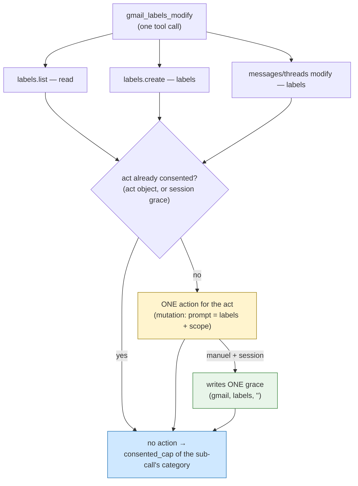

# ADR-0014 — `gmail_labels_modify` in the transactional model: one multi-call act, a single consent

**Date**: 2026-10-01
**Status**: proposed (applies ADR-0013; opt-in feature, OFF by default)
**Deciders**: Thomas (maintainer)
**Builds on**: [ADR-0013](ADR-0013-consent-once-or-session.md) · [ADR-0012](ADR-0012-transactional-consent-propagation.md) · [ADR-0011](ADR-0011-transactional-consent-per-session.md) · [ADR-0007](ADR-0007-per-session-rights.md)

> **In plain terms** — The `gmail_labels_modify` tool (PR #156) was not wired into transactional consent: it was refused as early as the internal read and did not offer the "for the session" choice. We wire it in. The specific difficulty: *one* tool call = *several* broker calls (list labels, create them, modify messages, modify threads) of *two* categories (`read` to resolve names, `labels` to apply/remove). We therefore consent **once for the whole act**, then each sub-call is authorized under that consent. In `manuel` + `session` mode, the act writes **one** *account-scoped* grace `(gmail, labels, "")` that also covers the resolution read — never a broad `gmail:read` grace. *The tool verifies, the human authorizes, the LLM proposes.*

---

## Context

[ADR-0013](ADR-0013-consent-once-or-session.md) set the "once / for the session" consent and wired it onto the **Drive mutations** (`drive_create`, `drive_update`, `drive_copy`, `drive_upload`). Each is **one** tool call = **one** broker call = **one** action.

`gmail_labels_modify` arrived **afterwards** (PR #156) and was never connected. Three symptoms, reproducible with the `gmail-cleanerz` CLI as well as with the agent in conversation:

1. **Read refused.** The tool calls `labels.list` (category `gmail.read`) to resolve name → id. In transactional mode, the broker authorizes a call only through the **consented capability carried by that call** (ADR-0012, Zone 1), not through the session's persisted capabilities. Without threaded consent: `read « gmail » outside session capabilities (gmail:read)`.
2. **No more minutes-based unlock.** ADR-0013 removed it; `session_unlock_in_conversation` points to "for the session". The out-of-band escape hatch is closed.
3. **No `grant_scope`.** The tool's MCP schema does not expose it; the act cannot carry the "for the session".

**The hard point.** Unlike a Drive mutation, `gmail_labels_modify` **unfolds** into several broker calls of **two categories**:

```
labels.list      → read    (resolving label names)
labels.create    → labels  (creating missing ones, if create_missing)
messages.batchModify → labels  (apply/remove on messages)
threads.modify   → labels  (apply/remove, one call per thread)
```

Gating each sub-call separately would require **several** Touch IDs for **one** "apply a label". And since reading (`read`) and writes (`labels`) are distinct categories, a single `labels` grace would not suffice to cover the read: we must decide **how a single consent covers both**.



*Figure 1 — The sub-calls of a single act converge on one decision point. The first to arrive (the resolution read) triggers THE action of the act; the following ones pass without action. In `manuel` + `session`, an account-scoped grace is written, which will also cover the resolution read of subsequent acts.*

---

## Decision 1 — A multi-call act, a single consent, via an act object

**Decision.** `gmail_labels_modify` creates an **act object** (a Python `dict`, `{"granted": False, "summary": …}`) and threads it, along with `grant_scope`, into **each** of its `_run` sub-calls. The transactional gate (`_transactional_gate`) recognizes a label-act sub-call and routes it to `_gmail_label_act_gate`. This gate:

1. if the act is **already consented** (`granted == True`, set by a previous sub-call **of the same act**) → authorizes without action;
2. otherwise, if a **grace** `(gmail, labels, "")` already covers the mailbox (`manuel` mode) → marks the act consented, authorizes without action;
3. otherwise → **one** signed action for the entire act (curation is a mutation → action in `auto` as in `manuel`), marks the act consented, then — if `manuel` + `session` — writes the grace.

Each sub-call receives the `consented_cap` of **its** category: `read` for `labels.list`, `labels` for writes. The broker re-verifies each one (Zone 1) — **unchanged**.

**Why an (in-memory) act object and not just the grace.** The grace lives only in `manuel` + `session` mode. For `grant_scope=once` (the **default**) and `auto` mode to also cost **a single** action per act, "the act is consented" must be remembered for the duration of the call, persisting nothing. The act object is that memory: it is born and dies with the `gmail_labels_modify` call, is **never** exposed in the MCP schema (the client cannot fabricate it), and the gate honors it only for a `gmail` sub-call of category `read` or `labels` (upstream guard; everything else falls back to the normal gate).

**Alternative rejected.** Gate each sub-call independently (as for Drive). Rejected: several Touch IDs for one act — exactly the "unusable" observed.

**Fail-closed fallback.** Act object absent → normal gate (one action per sub-call). Category outside `{read, labels}` on an act sub-call → normal gate (never the act shortcut). Action refused → `GatewayError(code="locked")`, no target modified.

---

## Decision 2 — The curation grace is *account-scoped*, and covers the resolution read

**Decision.** In `manuel` + `session`, the act writes **a single** grace `session_grant_capability_session_lived(sid, alias, "gmail", "labels", "")` — **empty** resource (account-scoped). `session_has_capability` already treats a capability **without a resource** as covering every `service × operation` of that account. The scope of a label curation **IS the mailbox**: there is no finer resource that is stable (a `messages modify` carries `addLabelIds` **and** `removeLabelIds` → ambiguous operand, excluded from `_OPERAND_PARAM` on purpose since backlog item 0080).

This single `labels` grace **also** covers the act's `labels.list` read: `_gmail_label_act_gate` authorizes the `read` sub-call as soon as the act is consented (grace present or action done). We therefore **never** persist a `gmail:read` grace. This is the "**act-bound sub-grant**": the read is subordinate to the curation act, not a standalone Gmail read access.

**Why account-scoped is safe here (and refused for Drive).** For Drive, a write with no derivable resource falls back to "once" (ADR-0013 Decision 2): a service-wide Drive grace would be too broad. For labels, account scope **is** the right scope, and it remains **doubly bounded**:

- by the `gmail.labels` **account policy** (ADR-0007 intersection, unchanged);
- by the **"never a system label" safeguard** — `gmail_labels_modify` refuses TRASH/SPAM/INBOX… before any call, and `categorize.gmail_labels_override` reclassifies a `modify` touching a system label as `delete`/`update` (therefore **outside** `labels`), so the `(gmail, labels)` `consented_cap` **would not authorize it** at the broker.

The grace therefore loosens only the **curation of user labels** — never a send, a deletion, a trash, a share.

**Alternative rejected.** Persist a `(gmail, read, "")` grace to cover resolution. Rejected: such a grace would authorize **any** Gmail read in the session (messages, contents) — far beyond name resolution. The act-bound sub-grant gives exactly what is needed, no more.

**Fail-closed fallback.** Outside `manuel` (`auto` mode) or **delegated sub-session** → no grace; `scope` normalized to `once` (honest receipt). Grace write failure → the already-approved act **does not fail** (safety net, as in ADR-0013 batch 6).

---

## Decision 3 — `grant_scope` at the edge, like the Drive mutations

**Decision.** `grant_scope` (enum `once`/`session`, default `once`) is exposed in the MCP schema of `gmail_labels_modify` (`_GRANT_SCOPE_PROPERTY`), extracted at dispatch, added to the signature of `api.gmail_labels_modify`, and threaded into its `_run` calls. **Never** on sharing or drafts (ADR-0013 Decision 4 safeguard, unchanged). The LLM fills in this parameter when the user says "for the session"; the human **reads** the scope in the Touch ID prompt and confirms.

**Consequence.** Ergonomics join Drive's: a single parameter, a signed receipt naming the act (`gmail:users:labels:modify`), the labels applied/removed and their number of targets, and the chosen scope.

---

## Fail-closed fallback (summary)

- Transactional flag OFF → behavior as before, bit for bit (the act object is ignored).
- Scope absent/unknown → `once`. `auto` mode / sub-session → `session` normalized to `once`, no grace.
- Act object absent, or sub-call outside `gmail:{read,labels}` → normal gate (one action per sub-call).
- System label → refused upstream AND reclassified outside `labels` → not authorized by the act's cap.
- Action refused, cap unreadable, lock failing → refusal, never access; no target modified.
- Sharing and drafts have neither `grant_scope` nor a grace.

---

## Consequences

- **Usable.** Applying `gc/to-delete` to a thread costs **one** "for the session" action; subsequent acts in the session, **zero**. The resolution read is covered with no separate grant.
- **Safe.** The only thing loosened "for the session" is the curation of user labels on a mailbox, bounded by policy + system guard. No broad `gmail:read` grace exists.
- **Debt-free.** Reuses ADR-0013's plumbing (`session_grant_capability_session_lived`, `session_has_capability`, `_consented_cap`, `run_elicitation_gate`, `categorize`); no duplicated source of truth; the broker is unchanged.

---

## References

- ADRs: [ADR-0013](ADR-0013-consent-once-or-session.md) (applied here), [ADR-0012](ADR-0012-transactional-consent-propagation.md), [ADR-0011](ADR-0011-transactional-consent-per-session.md), [ADR-0007](ADR-0007-per-session-rights.md).
- Backlog item: `features/20261001214857000_gmail-labels-modify-transactionnel.md`.
- Code: `gateway/api.py` (`gmail_labels_modify`, `_run`, `_transactional_gate`, `_gmail_label_act_gate`, `_consented_cap`, `_is_delegated_session`), `gateway/sessions.py` (`session_grant_capability_session_lived`, `session_has_capability`), `gateway/categorize.py` (`categorize`, `gmail_labels_override`, `operand_resource`), `gateway/mcp_server.py` (`_GRANT_SCOPE_PROPERTY`, schema + dispatch), `gateway/broker_server.py` (Zone 1 — unchanged).
