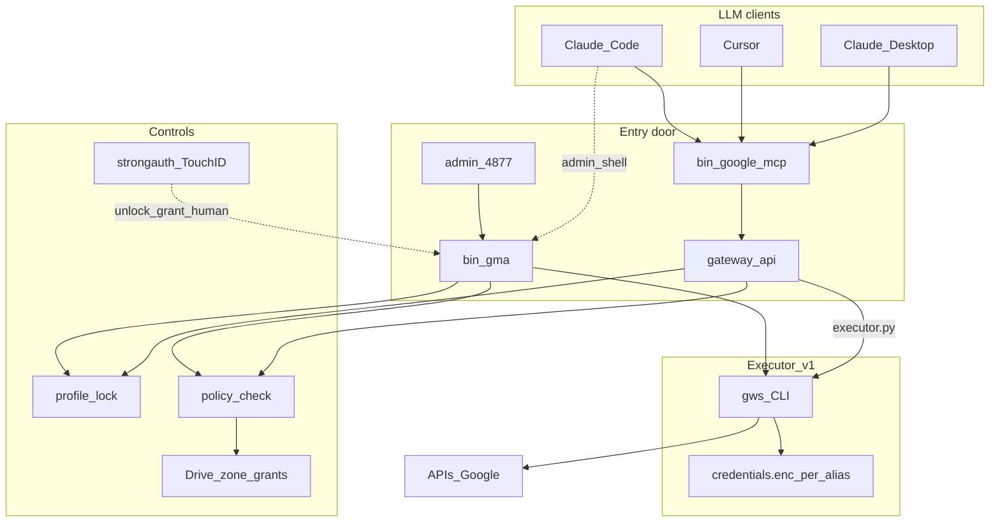

# Under the hood — the architecture

This page explains **how the project is built**: which pieces exist, who talks to
whom, and — above all — **where the safeguards are** that stop the assistant from
acting on its own. It is for anyone who wants to understand or audit the system; to
just get started, go to **[Getting started](getting-started.md)** instead.

One principle runs through everything below:

> **The tool verifies, the human authorizes, the LLM proposes.**
> The assistant can *ask* for access; it can never grant it to itself.

## The idea in one picture

Everything runs **on your machine** — nothing is hosted in an application cloud.
Your assistant talks to the MCP server; the server goes through a **gateway** that
checks two things before every call to Google: is the account **unlocked**? Is the
action **allowed by the policy**? You, the human, act from the other side — the `mag`
CLI or the admin interface — to open or close these accesses. The two sides meet on
the same **state** (locks, grants, policy) without either being able to command the
other.



The detailed sequence diagrams (reading data, connecting an account, repairing
access) are in [`diagrams/`](https://github.com/elzinko/google-mcp-multi-account/tree/main/diagrams/).

## Where things live

On the workstation, six layers take turns:

| Layer | Artifact | Role |
|-------|----------|------|
| LLM clients | Claude Desktop, Cursor, Claude Code | Call the MCP (data) or the shell (admin) |
| MCP | [`bin/google-mcp`](https://github.com/elzinko/google-mcp-multi-account/blob/main/bin/google-mcp) → [`gateway/`](https://github.com/elzinko/google-mcp-multi-account/tree/main/gateway/) | The **recommended** entry point for Gmail/Drive |
| Human CLI | [`bin/mag`](https://github.com/elzinko/google-mcp-multi-account/blob/main/bin/mag) | Multi-account: `add`, `lock`/`unlock`, `grant`, `policy` |
| Human cockpit | [`admin/server.js`](https://github.com/elzinko/google-mcp-multi-account/blob/main/admin/server.js) `127.0.0.1:4877` | Local web interface (never exposed beyond loopback) |
| Policy | [`scripts/policy-check.py`](https://github.com/elzinko/google-mcp-multi-account/blob/main/scripts/policy-check.py) | Checks "default-deny" before any call to Google |
| Google execution | `gws` + `~/.config/gws-accounts/<alias>/` | Encrypted tokens + API calls |

Since Phase 2 A, `gws` is no longer launched all over the place: a local **broker**
([`bin/google-broker`](https://github.com/elzinko/google-mcp-multi-account/blob/main/bin/google-broker),
started automatically, listening on `127.0.0.1:4878`) is the **only** component that
runs it to access data. The gateway only talks to the broker. Credentials stay under
`~/.config/gws-accounts/` (the dedicated vault is planned — backlog item `features/0003-vault-credentials-hors-perimetre-agent.md`).

### Two names not to confuse: the repository and the connector { #noms-depot-connecteur }

You will come across two very similar identifiers. This is not an inconsistency; it is
the MCP convention:

| Name | What it refers to | Where you see it |
|-----|------------------|---------------|
| **`google-mcp-multi-account`** | the **repository / project** (and the name the server announces, `mcp_server.py:SERVER_NAME`) | GitHub URL, cloned folder, `bin/google-mcp` binary, `~/.local/share/google-mcp/` install |
| **`google-multi-account`** | the **installed connector** — the key under `mcpServers` in the client config | Claude Desktop → Connectors, `claude mcp get` |

The repository carries `mcp` (discoverable, self-describing); the connector is shorter
because it already lives under `mcpServers` — repeating "mcp" there would be
redundant. Same pattern everywhere: `github/github-mcp-server` → connector `github`;
the `mcp-server-git` package → connector `git`. The CLI, for its part, is called **`mag`**.

## The components, one by one

### The gateway (`gateway/`)

This is the core: it receives calls from the MCP server and lets none of them through
without a check.

| Module | Responsibility |
|--------|----------------|
| `api.py` | The public contract: `profiles_list`, `gmail_*`, `drive_*`, `access_request` |
| `profiles.py` | Aliases, locks, profile listing |
| `executor.py` | RPC client to the broker (no more `gws` calls here) |
| `broker_server.py` | The `127.0.0.1:4878` daemon — lock + policy + audit log + `gws` |
| `default_policy.py` | The "cautious" policy written at `mag add` |
| `mcp_server.py` | The MCP stdio adapter (JSON-RPC, **stdlib only**) |
| `errors.py` | `GatewayError` (`locked`, `policy`, `alias`, …) |

Concretely, a call like `gmail_list` goes through five steps: it **validates the
alias**, **refuses if the profile is locked** (with an elicitation message), passes the
command to the **policy-check**, **logs it**, and only then executes. And
`access_request` never unlocks or grants anything: it **returns the exact command**
that the human will have to run (`mag unlock`, `mag grant`).

### The exposed MCP tools

Deliberately few and unsurprising — there is no generic "run any command" tool. Each
one reads or writes something precise:

| Tool | Effect | Sends mail? |
|------|--------|-------------|
| `profiles_list` | Lists aliases / lock / policy | — |
| `gmail_list` / `gmail_get` | Read | No |
| `gmail_draft_create` | Draft | No (no `send` tool) |
| `gmail_attachment_get` | Read — attachment written to `.downloads` ([ADR-0006](adr/ADR-0006-received-files-dedicated-directory.md)) | — |
| `drive_list` / `drive_get` | Read, including the owner | — |
| `drive_read` | Content as text (Doc → markdown, Sheet → CSV) | — |
| `drive_create` / `drive_update` | Create / modify under an authorized zone ([ADR-0003](adr/ADR-0003-drive-content-via-broker-deposit.md)) | — |
| `drive_copy` / `drive_upload` | Native copy / upload, under a zone | — |
| `drive_permissions_*` | Read/write sharing (`share` policy) | — |
| `access_request` | Returns a command for the human to run | — |

### The `mag` CLI

The human control station. It isolates each account in its own directory
(`~/.config/gws-accounts/<alias>/`), writes a cautious policy at connection time, and
exposes the human controls (`lock`, `unlock`, `grant`, `policy`). Before any call to
`gws`, it checks the lock and then the policy. Its interpreters use **absolute**
paths (`/usr/bin/python3`, `/usr/bin/swift`) — so a fake `python3` at the front of
PATH cannot quietly disable the policy.

### The policy (`policy-check.py`)

When a `policy.json` exists, the rule is **"default-deny"**:

| Rule | Behavior |
|------|----------------|
| **Undeclared** service | **Refused** (e.g. `chat`, `meet`) |
| Declared service | Fail closed by category (`read`, `send`, `create`, …) |
| Drive `zonesOnly` | Writes only under authorized folders ∪ temporary grants |
| Corrupted JSON | Refused (fail closed) |

The default preset is deliberately cautious (`gateway/default_policy.py`): Drive with
no write zone, Gmail with read + drafts **without sending**, everything else
essentially read-only.

### Per-session rights (`sessions.py`)

On top of the policy (the workstation's floor), each **conversation** carries its
**own** rights, signed and short-lived ([ADR-0007](adr/ADR-0007-per-session-rights.md)).
A session's identity is not the MCP connection but a **token** that the human creates
with a signed action (`mag session open`) and that the assistant presents **on every
call** — so two conversations on the same connection stay isolated.

| Aspect | Behavior |
|--------|----------|
| **Granularity** | Capabilities per **service × operation × resource** (resource optional: Drive zone, Gmail label…) |
| **Granting** | `mag session unlock\|grant\|grant-capability` — **always signed** (never a silent widening) |
| **Effective** | account policy ∩ project manifest ∩ session capabilities (∩, *fail closed*; anti-downgrade if the manifest is tampered with) |
| **Lifecycle** | TTL + explicit revocation; MCP disconnection purges **nothing**; registry `.sessions/<token>.json` |
| **Sub-agents** | Inheritance ⊆ parent, no autonomous widening, cascading revocation |
| **Bootstrap** | Without a token: no data access, only the creation request (`mag session open`) |

### The admin interface

A small local web UI, designed to stay harmless: it listens **only** on
`127.0.0.1:4877`, requires an `X-GWSA-Admin` header and checks the `Origin`
(anti-CSRF), acts only through `execFile(mag)` (never a shell), and has no
application-level authentication — the trust is "we are on the local machine".

### Where the secrets are

| Item | Location |
|---------|-------------|
| Encrypted OAuth tokens | `~/.config/gws-accounts/<alias>/credentials.enc` |
| Master key | macOS Keychain (`gws-cli`), via `gws` |
| `client_secret.json` | `~/.config/gws-accounts/` (outside the repository) |
| Policy / grants / lock | Files in the profile folder |
| Audit log | `~/.config/gws-accounts/usage.jsonl` |

## What each safeguard protects — and its limit

The table is deliberately honest in its last column: every control has a condition
that bypasses it.

| Control | Where | Against what | Bypassable if… |
|----------|-----|-------------|------------------|
| Default-deny policy | `policy-check.py` | Sending, unlisted services, writes outside zones | The agent calls `gws` **outside** `mag`/the gateway |
| Drive zones + grants | policy + `session-grants.json` | Writes outside authorized folders | Same, bare `gws` |
| Per-session rights | `sessions.py` + broker | Rights leaking between conversations; unsigned widening | The agent calls `gws` **outside** the gateway (cooperative until the vault) |
| Profile lock | `.locked` / `.unlock-until` | Access without your go-ahead | Editing the files, or bare `gws` |
| MCP tools without `send` | `mcp_server.py` | Sending mail via the MCP | Another client / the shell |
| Non-executing `access_request` | `api.py` | Self-unlocking by the LLM | The human (or an agent) runs the command |
| Touch ID (strongauth) | `touchid.swift` | Unlock/grant without physical presence | Forged PATH: **no** (absolute swift); editable lock files: yes |
| Loopback admin + anti-CSRF | `admin/server.js` | A remote website | A malicious **local** process |
| `usage.jsonl` audit log | 3 write paths | Cooperative audit | `GWSA_CLIENT` can be forged |

**In plain terms (Phase 1):** this is the **discipline of a cooperative agent** (MCP +
policy + lock), not a prison. It is **not** isolation against an agent that has a free
shell and access to the credential files — this is stated in black and white in the
**[threat model](threat-model.md)**.

## The three paths to know

**The supported path** (data goes through here):

```text
LLM  →  MCP tools  →  gateway  →  policy + lock  →  broker (gws)  →  Google
```

**The human path** (you open/close accesses):

```text
Human  →  admin OR mag unlock|grant|policy  →  (Touch ID?)  →  profile files
```

**The path to block** on the agent's permissions side:

```text
LLM  →  shell  →  GOOGLE_WORKSPACE_CLI_CONFIG_DIR=… gws …
```

The countermeasure: deny the agent, in its shell permissions, bare `gws` calls and
edits to `~/.config/gws-accounts/` — data goes through the MCP **only**.

## Where the product stands

| Phase | State | Content |
|-------|------|---------|
| **1** | **Deployed** | MCP + gateway + default-deny + docs |
| **2 A** | **Deployed** | Loopback broker: `gws` only inside the broker |
| **Rights/session** | **In progress** — [ADR-0007](adr/ADR-0007-per-session-rights.md) | Signed token carried per call, fine-grained capabilities per conversation, isolation, audit |
| **2.1** | Planned — backlog item `features/0003-vault-credentials-hors-perimetre-agent.md` | Credentials vault out of the agent's reach |
| **3** | Idea — backlog item `features/0001-elicitation-signee-strongauth-v2.md` | Elicitation signed by the Secure Enclave |

## To go fast

The files that matter, and how to check that everything is fine:

```text
bin/google-mcp          # MCP stdio entry
bin/google-broker       # daemon (runs gws)
bin/mag                 # the multi-account CLI
gateway/                # API + MCP + executor + broker
scripts/policy-check.py # policy enforcement
admin/server.js         # UI 127.0.0.1:4877
```

```bash
./scripts/test.sh                 # policy + gateway + MCP smoke (hermetic)
mag list                          # your accounts
mag policy vous@gmail.com show    # an account's active policy
```
